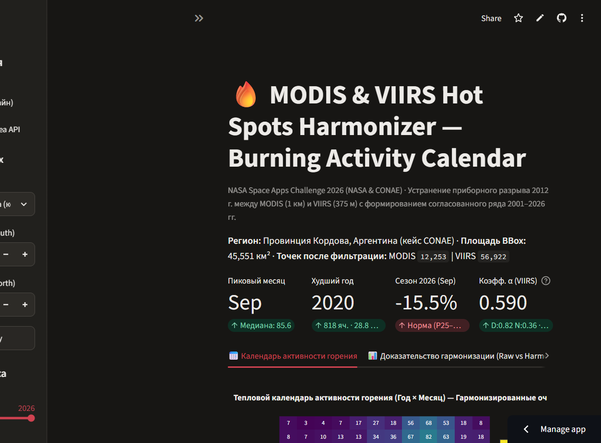
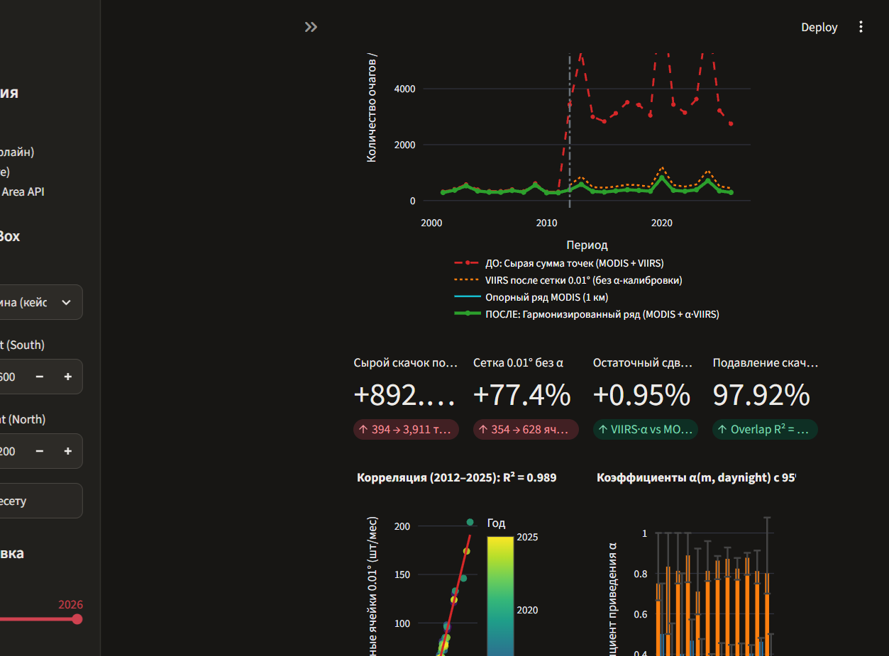
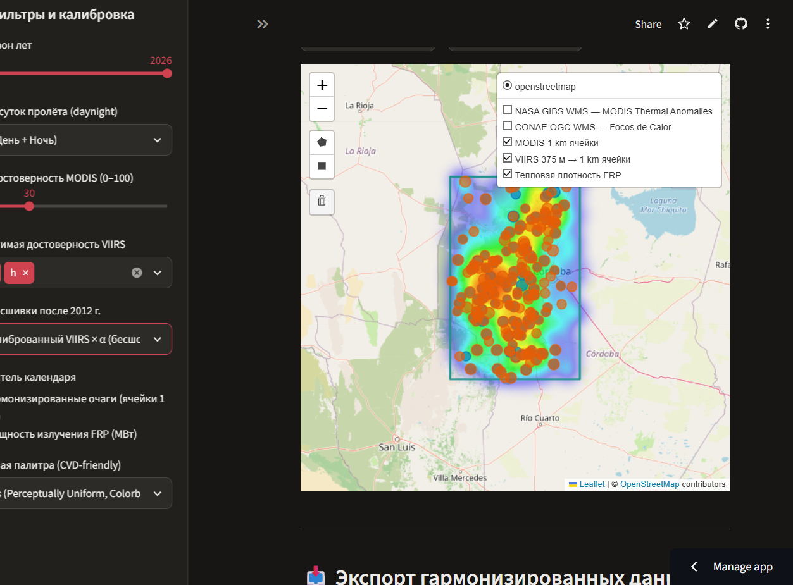

# Harmonization of MODIS and VIIRS Hot Spots (NASA Space Apps Challenge 2026)

**Live Web App (Streamlit Community Cloud):** [https://fire-harmonizer-klk4prhsumtdpkv23tsafg.streamlit.app/](https://fire-harmonizer-klk4prhsumtdpkv23tsafg.streamlit.app/)

Web platform and statistical harmonization pipeline that removes the 2012 cross-sensor discontinuity between **MODIS (1 km)** and **VIIRS (375 m)** active fire detections to produce a climatology-ready **Burning Activity Calendar (2001–2026)** — built for the NASA & CONAE challenge [Harmonization of MODIS and VIIRS Hot Spots](https://www.spaceappschallenge.org/2026/challenges/modis-and-viirs-hot-spots/).

---

## Dashboard Previews

| Burning Activity Calendar | Harmonization Proof (Raw vs. Harmonized) | Geospatial Explorer & CSV/JSON Export |
| --- | --- | --- |
|  |  |  |

---

## 1. The MODIS vs. VIIRS Discontinuity Problem

Long-term active-fire archives from [NASA Earthdata FIRMS](https://www.earthdata.nasa.gov/data/tools/firms) span two sensor generations with mismatched spatial resolution and sensitivity:

| Parameter | MODIS (Terra / Aqua, `MCD14DL`) | VIIRS (Suomi NPP, `VNP14IMG` · NOAA-20/21 Live NRT) | Impact on Multi-Decadal Series |
| --- | --- | --- | --- |
| **Operational Era** | Nov 2000 – Present (`Terra` only before `2002-07-04`) | Mar 2012 – Present (SNPP C2 archive) | Artificial step-jump starting March 2012 |
| **Nadir Pixel Footprint** | `1 km × 1 km` | `375 m × 375 m` | One MODIS hotspot splits into ~4–7 VIIRS subpixels |
| **Small & Nighttime Sensitivity** | Standard (`MIR/TIR`) | Higher sensitivity to smoldering / small nighttime fires | Inflates nighttime and low-intensity detection counts |
| **Confidence Schema** | Numeric `0–100` | Categorical `'l'` / `'n'` / `'h'` | Incompatible filtering attributes |

---

## 2. 4-Stage Harmonization Pipeline (`src/harmonizer.py`)

1. **Sensor Unification & Confidence Filtering:**
   - **MODIS:** retains `confidence >= threshold` (default `30`), normalized confidence weight $w = \text{confidence} / 100$.
   - **VIIRS:** retains `confidence ∈ {'n', 'h'}` by default (weights `{'l': 0.25, 'n': 0.75, 'h': 1.0}`).
2. **Swath Geometry & FRP Density Normalization:**
   $$\text{pixel\_area\_km2} = \max(\text{scan} \times \text{track},\ 0.05), \qquad \text{frp\_density} = \frac{\text{FRP}}{\text{pixel\_area\_km2}} \quad [\text{MW/km}^2]$$
3. **Spatiotemporal Gridding onto $0.01^\circ \times 0.01^\circ$ (`~1 km`):**
   - Aggregates sub-pixel detections by `(grid_lat, grid_lon, acq_date, daynight)` into unified active fire cells (`active_cell_count = 1`), preserving raw detection counts (`raw_point_count`) and summed radiative output (`frp_sum`).
4. **Stratified Sum-Ratio Calibration $\alpha(\text{D/N}, m)$ with Empirical-Bayes Shrinkage (`2012-03 .. 2025` Overlap):**
   - Rather than taking biased per-month median ratios or using arbitrary fallback constants, global Day (`D`) and Night (`N`) scaling factors optimize total concurrent count conservation per overpass, blended with each calendar month $m \in \{1 \dots 12\}$ via shrinkage weight $w_m = \min(0.35,\ \frac{n_m}{n_m + 12})$ and exact per-overpass sum normalization:
     $$\alpha_{\text{global}}(d) = \frac{\sum_{t \in \text{overlap}} \text{MODIS}_{d}(t)}{\sum_{t \in \text{overlap}} \text{VIIRS}_{d}(t)}, \qquad \text{Harmonized}(t) = \begin{cases} \text{MODIS}(t), & t < \text{2012-03} \\ \sum_{d \in \{D,N\}} \alpha(m, d)\cdot \text{VIIRS}(t, d), & t \ge \text{2012-03} \end{cases}$$
   - Uncertainty intervals (**95% bootstrap CI**) are computed by resampling paired overlap months with replacement (no degenerate point-mass fallbacks; unobserved/sparse strata emit `NaN` CIs and `calibration_status = "no_data"`).
   - Multi-decade monthly calendars preserve unobserved periods as `data_status = "no_data"` (`NaN`, rendered gray in heatmaps) rather than `0`, evaluate anomalies via **Leave-One-Out Robust Z-scores** (`0.7413 · IQR`), test for multi-year **non-stationarity**, and extract **52-week Critical Fire Risk Windows** (`P(Weekly > P75)`).

---

## 3. Verification Results (Verified via `python -m src.analytics`)

### 3.1. Real Satellite Archive — Córdoba Province, Argentina (`2001–2025`, `data/real/`)

Dataset: **`21,330` MODIS C6.1 (`MCD14DL`)** and **`37,294` Suomi NPP VIIRS C2 (`VNP14IMG`)** detections inside `[-65.6, -32.6, -63.8, -30.2]`. Pre/post transition comparison evaluates complete dual-MODIS reference years **`2003–2011` vs. `2013–2025`**.

| Metric (Real NASA FIRMS Córdoba 2001–2025) | Observed Value |
| --- | --- |
| **Raw Step-Jump (`2003–2011` → `2013–2025`)** | **`+235.80%`** (`981.7` → `3,296.5` pts/yr) |
| **Gridded 0.01° Without α (`2003–2011` → `2013–2025`)** | **`+27.86%`** (`901.6` → `1,152.7` cells/yr) |
| **Harmonized Change vs. MODIS-Only Physical Trend** | **`-32.09%`** harmonized vs. **`-31.84%`** MODIS natural (`901.6` → `612.3` cells/yr) |
| **Step-Jump Suppression** | **`86.39%`** |
| **In-Sample Overlap Residual Bias (`2012-03..2025`)** | **`-0.00%`** |
| **Out-of-Sample Holdout Bias (`2012–2018` → `2019–2025`)** | **`-12.99%`** |
| **Overlap Agreement ($R^2$ / $r$ / Deseasonalized $r$)** | **$R^2 = 0.9805$** · $r = 0.9902$ · Deseasonalized $r = 0.9893$ |
| **Sum-Ratio Calibration α (`VIIRS → MODIS`)** | **`Overall = 0.5310`** · **`Day = 0.6564`** · **`Night = 0.3535`** (`Mean 95% CI Width = 0.0826`) |
| **Peak Climatology Month / Worst Year** | **`Sep`** (`median = 160.0`) / **`2003`** (`2,144.0` cells) |
| **Peak 52-Week Critical Risk Window (`P > P75`)** | **`W35 (Aug 27)`** (`72.0%` of years exceed `P75 = 9.7` cells/wk) |

### 3.2. Algorithmic Self-Consistency Benchmarks (`data/sample/synthetic_*.csv`, `2001–2026`)

| Biome Preset (`2003–2011` vs `2013–2025`) | Raw Jump | Gridded Uncal. | Harmonized vs MODIS Natural | Overlap Bias | Holdout (2019–25) | Jump Supp. | Overlap $R^2$ | Deseas. $r$ | Sum-Ratio α (O / D / N) |
| --- | --- | --- | --- | --- | --- | --- | --- | --- | --- |
| **Córdoba, Argentina** | `+898.3%` | `+78.4%` | `+18.13%` vs `+18.31%` | **`+0.00%`** | `+0.76%` | `97.98%` | `0.9917` | `0.9864` | `0.6622` / `0.8409` / `0.3591` |
| **Ukraine Forest & Steppe** | `+794.6%` | `+60.4%` | `+5.77%` vs `+5.86%` | **`+0.00%`** | `-2.53%` | `99.27%` | `0.9895` | `0.9862` | `0.6594` / `0.8405` / `0.3554` |
| **Northern & Central California** | `+825.3%` | `+66.0%` | `+8.77%` vs `+8.82%` | **`-0.00%`** | `+3.34%` | `98.94%` | `0.9921` | `0.9917` | `0.6554` / `0.8329` / `0.3554` |

---

## 4. Two-Mode Web Interface (`app.py`)

1. **Reference Case — Córdoba, Argentina (`2001–2025`):**
   - Loads the official 2001–2025 NASA FIRMS archive (`data/real/`) or switches to the 3-biome Algorithmic Self-Consistency Benchmarks (`data/sample/`).
   - Interactive Burning Activity Calendar (`No Data` gray masking, Leave-One-Out Robust Z anomalies, 52-week `P > P75` Critical Risk Windows, non-stationarity check), Harmonization Proof, Folium Map + NASA GIBS / CONAE WMS overlays, and CSV + `run_metadata_manifest.json` downloads.
2. **Explore Any Region (`Live API / Custom CSV`):**
   - Free global Bounding Box entry (`Min Lon`, `Min Lat`, `Max Lon`, `Max Lat`).
   - **Live NASA FIRMS Area API:** automatic **5-day chunking** per FIRMS specification, exponential backoff rate-limit retries, header validation prior to caching, and explicit warnings if any 5-day sub-window fails (`allow_partial=True`).
   - **Custom CSV Archive Upload:** supports comma/semicolon delimiters, optional `dayfirst` (`DD/MM/YYYY`) date parsing, CSV Load Diagnostics, and step-by-step FIRMS Archive instructions.

---

## 5. Project Structure

```text
fire_harmonizer/
├── app.py                   # Streamlit dashboard (3 tabs, Folium WMS overlays, CSV/JSON export)
├── requirements.txt         # Pinned dependencies
├── LICENSE                  # MIT License + NASA FIRMS / CONAE attribution & DOIs
├── PROGRESS.md              # Development & technical audit log
├── README.md                # Documentation and verification results
├── screens/                 # 01_burning_activity_calendar.png, 02_..., 03_...
├── data/
│   ├── real/                # Compact Córdoba 2001–2025 MODIS & SNPP VIIRS NASA FIRMS CSVs
│   ├── sample/              # synthetic_*.csv algorithmic self-consistency benchmarks
│   ├── processed/           # Exported harmonized monthly series, α tables, and calendars
│   └── raw/                 # Ignored local FIRMS ZIPs and validated API cache files
├── src/
│   ├── config.py            # Endpoints, Córdoba reference preset, validate_bbox
│   ├── data_loader.py       # FIRMS API client (backoff, 5-day chunks), CSV parser & diagnostics
│   ├── harmonizer.py        # 4-stage pipeline, sum-ratio α, bootstrap CI, holdout & anomaly metrics
│   └── analytics.py         # NaN-safe calendars, LOO Robust Z anomalies, 52-week critical windows
└── tests/
    ├── test_custom_global.py
    ├── test_harmonizer_real.py
    └── test_audit_compliance.py
```

---

## 6. Installation & Running Locally (Cross-Platform)

### 1. Create a Virtual Environment & Install Dependencies
**Linux / macOS:**
```bash
python3 -m venv .venv
source .venv/bin/activate
pip install -r requirements.txt
```

**Windows (PowerShell):**
```powershell
python -m venv .venv
.\.venv\Scripts\Activate.ps1
pip install -r requirements.txt
```
*(Optional on Windows: pass `--cache-dir E:\cache\pip` if storing pip wheels on a secondary drive.)*

### 2. Configure Optional Live API Key
Copy `.env.example` to `.env` and add your free key from [FIRMS Map Key](https://firms.modaps.eosdis.nasa.gov/api/map_key/):
```env
FIRMS_MAP_KEY=your_firms_map_key
```

### 3. Verify Pipeline, Tests & Launch Dashboard
```bash
python -m pytest -q
python -m src.analytics
streamlit run app.py
```

---

## 7. Scientific Scope, Limitations & Attribution  

1. **Suomi NPP (`VNP14IMG`) vs. NOAA-20 / NOAA-21 (`VJ114IMG`):** Multi-decade reference calibration uses Suomi NPP VIIRS Collection 2 (`VNP14IMG`, 2012–2025). Live NRT queries against `VIIRS_NOAA20_NRT` inherit orbital timing differences (~50 min offset relative to SNPP) if mixed without platform stratification.
2. **Pre-Aqua Baseline (`2001–2002`) & Complete Years:** Only Terra MODIS operated prior to `2002-07-04`, so pre/post transition step comparisons (`evaluate_2012_transition`) anchor at `2003–2011` vs. `2013–2025` complete dual-MODIS years to avoid orbital sampling bias. Partial current years (`2026 YTD`) are excluded from annual totals.
3. **Synthetic Benchmarks (`data/sample/synthetic_*.csv`):** Designed solely for **algorithmic self-consistency verification** (confirming known synthetic shifts are recovered without introducing artifacts). Physical claims apply exclusively to official NASA FIRMS observations (`data/real/` or uploaded/fetched FIRMS datasets).
4. **Non-Stationarity & `No Data` Handling:** Fire regimes evolve over decades (land-use change, suppression policy, ENSO). Unobserved months remain explicitly marked `no_data` (`NaN`) and excluded from baseline percentiles.
5. **AI-Assisted Engineering Disclosure:** Core statistical logic, refactoring, and automated audit tests were developed and iteratively verified using AI coding assistants alongside human domain review and NASA FIRMS / CONAE reference documentation.

### Official Data Citations & Links
- **MODIS Active Fire (`MCD14DL`):** NASA FIRMS (`10.5067/FIRMS/MODIS/MCD14DL.NRT.0061`)
- **VIIRS I-Band Active Fire (`VNP14IMGTDL`):** NASA FIRMS (`10.5067/FIRMS/VIIRS/VNP14IMGTDL.NRT.002`)
- **NASA FIRMS Portals:** [FIRMS Portal](https://firms.modaps.eosdis.nasa.gov/) · [Global Fire Map](https://firms.modaps.eosdis.nasa.gov/map/) · [API Docs](https://firms.modaps.eosdis.nasa.gov/api/) · [Archive Download](https://firms.modaps.eosdis.nasa.gov/download/) · [Country Yearly Summary](https://firms.modaps.eosdis.nasa.gov/country/)
- **CONAE Argentina:** [Catálogo de Geoservicios OGC CONAE](https://catalogos.conae.gov.ar/catalogo/catalogoGeoServiciosOGC.html) · [Focos de Calor CONAE](https://catalogos.conae.gov.ar/catalogo/actualizaciones.html)
- **License:** [MIT License](LICENSE)
